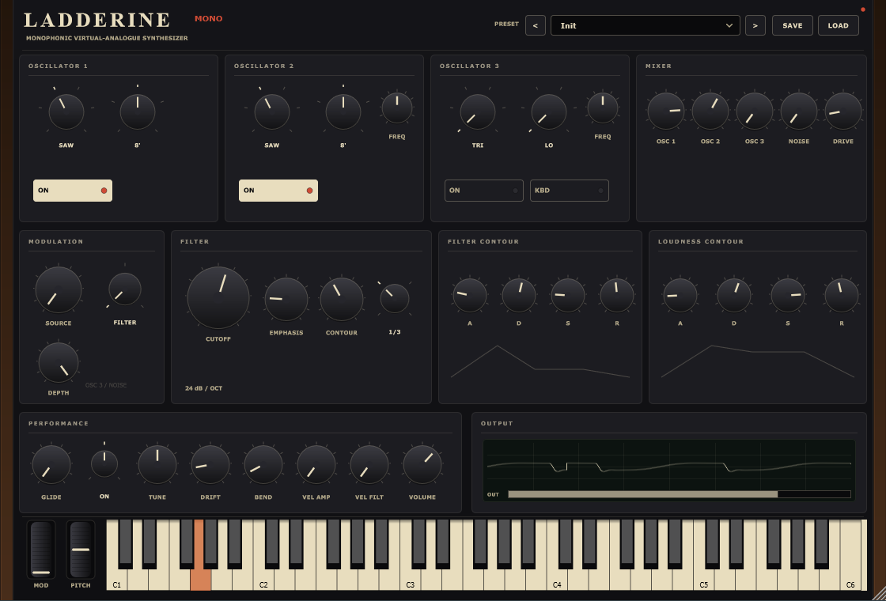

# Ladderine

A monophonic virtual-analogue synthesizer for JUCE, built as a VST3 plugin and a
standalone instrument. Three free-running oscillators, an overdrivable mixer, a
zero-delay-feedback 4-pole ladder low-pass, two contours, glide and the
oscillator-3/noise modulation bus.



Ladderine is an independent instrument. It contains no Felucca firmware code and
is not a wrapper around Felucca-Engines — see [Relationship to
Felucca](#relationship-to-felucca) for why and what that means.

The plugin identifies itself as manufacturer **Ddex**, plugin code **Lddr**
(VST3), with `duddex` as the company and `Ladderine` as the product.

## Features

- **Three oscillators**, each with six waveform positions (triangle, tri-saw,
  saw, square, pulse, narrow pulse) and five footages (32', 16', 8', 4', 2').
  Oscillators free-run; notes never reset their phase.
- **Oscillator 3** adds a **LO** setting and a keyboard-control switch. In LO it
  is a 0.1–20 Hz modulation source; otherwise it can be an audio partial.
  Oscillator 2 has a ±7 semitone frequency control, oscillator 3 the same
  (which sets the LFO rate in LO).
- **Noise** and a **mixer overload** control that soft-clips the sum before the
  filter.
- **4-pole ladder low-pass**, zero-delay feedback, 24 dB/oct, self-oscillating
  above ~4.1 resonance. Cutoff (20 Hz–20 kHz), emphasis, contour amount and
  keyboard tracking (off, 1/3, 2/3, full).
- **Two exponential contours**: filter A/D/S/R and loudness A/D/S/R, with
  musically scaled times from 1 ms to 10 s. Velocity can be routed to either
  (off by default, as on the original).
- **Glide** with off / on / auto modes, last-note priority, single-trigger
  legato behaviour and sustain-pedal handling.
- **Modulation**: oscillator 3 / noise crossfade, destination filter / pitch /
  both, depth, and a sprung pitch wheel with a 1–12 semitone range.
- **Analog drift**: slow, per-oscillator and per-filter random detuning,
  plus a tiny noise floor that lets the ladder start oscillating like the
  hardware.
- **12 factory presets**, host-automatable parameters, session save/restore,
  and user preset save/load as `.ladderinepreset` files.
- **On-screen 5-octave keyboard**, mod/pitch wheels, and a triggered
  oscilloscope with an output meter.
- **Real-time safe**: no allocation and no locks in the audio path. One
  monophonic voice; a full render is a few percent of one core.

## Building

Requirements: CMake 3.22 or newer and a C++20 compiler (developed with Visual
Studio 2026 on Windows). JUCE 9.0.5 is fetched with CMake FetchContent, so the
first configure needs network access.

```powershell
git clone https://github.com/duddex/ladderine.git
cd ladderine
cmake -S . -B build
cmake --build build --config Release
ctest --test-dir build -C Release --output-on-failure
```

The binaries are written to:

```
build/Ladderine_artefacts/Release/VST3/Ladderine.vst3
build/Ladderine_artefacts/Release/Standalone/Ladderine.exe
```

Copy the `Ladderine.vst3` bundle to `C:\Program Files\Common Files\VST3` (needs
administrator rights). The standalone needs no installation.

The DSP tests run under `ctest`; see [Tests](#tests).

On macOS and Linux the same CMake project works. On macOS add `AU` to `FORMATS` in
`CMakeLists.txt` if you want an Audio Unit, and use the Xcode or Ninja
generator; on Linux use Ninja/Make and install the resulting VST3 into
`~/.vst3`.

## Releases

GitHub Actions builds and tests every push on Windows. Pushing a `v*` tag creates a release with a
zip of the VST3, the standalone app and the licence files.

## The panel

- **OSCILLATOR 1/2/3** — range, waveform, frequency (2 and 3) and on/off.
  Oscillator 3 also has keyboard control. The range knob on oscillator 3 starts
  at **LO**.
- **MIXER** — the three oscillator levels, noise, and overload.
- **MODULATION** — source mix (oscillator 3 ↔ noise), destination, depth. The
  physical mod wheel controls the amount; it follows MIDI CC 1 and the on-screen
  wheel.
- **FILTER** — cutoff, emphasis, contour and keyboard tracking. **FILTER
  CONTOUR** is the filter envelope; **LOUDNESS CONTOUR** is the amplifier
  envelope.
- **PERFORMANCE** — glide time and mode, master tune (±1 semitone), drift, pitch
  bend range, velocity-to-loudness, velocity-to-filter, master volume.
- **OUTPUT** — oscilloscope and level meter.
- **Preset bar** — factory presets, previous/next, save and load. Saving writes
  the complete parameter state to a `.ladderinepreset` file next to your other
  documents.

MIDI: note on/off, pitch bend, CC 1 (mod wheel), CC 64 (sustain), CC 120/123
(all sound/notes off). The plugin is monophonic with last-note priority and
single-trigger legato; overlapping notes glide when glide is on.

## DSP notes

The sound is deliberately not sample-accurate to any particular vintage
synthesizer; it is an instrument in that tradition.

- **Oscillators** use polyBLEP for the discontinuous saw and pulse waves. The
  triangle and the shark-fin tri-saw are naive shapes whose harmonics fall off
  quickly. Phases are never reset by notes, so the three oscillators keep their
  free-running relationships.
- **Ladder filter**: four TPT one-pole sections. The feedback path
  `u = x - k · tanh(y4)` is solved twice per sample, which keeps the cutoff
  accurate up to Nyquist and stable at any resonance. The tanh in the loop is
  what gives the resonance its compression and self-oscillation.
- **Contours** use exponential approaches; each stage reaches ~99% of its
  target in the displayed time. Sustain is tracked with a slow one-pole so
  turning the sustain knob does not step.
- **Glide** moves the played note exponentially in semitones; the first note
  after power-on snaps. `AUTO` snaps on a new phrase and glides only between
  overlapping notes.
- **Drift** is a set of slow random walks (one per oscillator plus the filter),
  scaled by the drift control. The filter input also carries a −114 dB noise
  floor so the ladder can start oscillating on its own.
- **No oversampling.** PolyBLEP keeps oscillator aliasing low, and the ladder is
  solved at the host rate. A 2× oversampled version would be the next step if
  you want the last few dB of high-register cleanliness at the cost of latency
  and CPU.
- The whole voice runs at the host's sample rate (44.1, 48, 88.2, 96 kHz, …);
  there are no rate-dependent tables.

Source layout:

```
src/
  PluginProcessor.*      JUCE processor, parameters, MIDI, state, presets
  PluginEditor.*         window, panel layout, painting
  Parameters.*           parameter IDs and layout
  presets/FactoryPresets.*
  engine/SynthEngine.*   the monophonic voice
  dsp/Oscillator.h
  dsp/LadderFilter.h
  dsp/Envelope.h
  dsp/Types.h
  ui/LookAndFeel.*       custom knobs, switches, combo boxes
  ui/Knob.h
  ui/SteppedKnob.*
  ui/Wheel.*
  ui/Scope.*
```

## Tests

The DSP core is JUCE-free, so it can be tested without a plugin host. The
`LadderineDspTests` target renders the voice to WAV files and checks tuning,
filter brightness, ladder self-oscillation, release behaviour, glide and
stability at extreme settings:

```powershell
cmake --build build --config Release --target LadderineDspTests
build\Release\LadderineDspTests.exe tests\out
```

The WAVs land in `tests/out` (ignored by git). `tests/analyze.py` prints peak,
RMS, DC and basic spectral checks; `tests/out/07_demo.wav` is a short phrase.

Current checks on this machine: A4 = 440.00 Hz, A5 = 880.00 Hz, ladder
self-oscillation within 1% of the cutoff, no non-finite samples at any tested
cutoff/emphasis/drive combination.

## Relationship to Felucca

Felucca and Felucca-Engines are separate repositories, not part of this one:

- **Felucca** — GPL-3.0-only firmware for the M-VAVE FM-1 hardware synthesizer:
  <https://github.com/hugelton/Felucca>.
- **Felucca-Engines** — the MIT-licensed DSP subset used by Felucca: six
  engines (ANALOG, LOFI, TRIO, WHEEL, NOISE, PHASE), a shared fixed-point DSP
  file and a table generator. It is built for a 32-bit microcontroller, renders
  in 32-sample blocks of `int32_t`, and its ANALOG engine has two oscillators,
  a 12 dB/oct state-variable filter and no second contour.

A classic three-oscillator mono voice needs a 24 dB/oct ladder and independent
filter and loudness contours, so this plugin has its own 32-bit float voice
instead of being an adapter around `eng_analog.c`. Nothing from Felucca or
Felucca-Engines is copied here. If you want the Felucca ANALOG engine as an
additional instrument mode, it can be added as a separate voice engine later;
that would be an integration of the MIT engine, not a replacement for this
voice.

Ladderine is an independent project, not an official Felucca or Hügelton
Instruments product. "Felucca" and "Hügelton Instruments" are names of Hügelton
Instruments. "Minimoog" and "Moog" are trademarks of Moog Music. Ladderine is
not affiliated with or endorsed by Moog or Hügelton.

## Licence

Ladderine is free software, licensed under the GNU Affero General Public
License, version 3 or (at your option) any later version. See
[`LICENSE`](LICENSE) and [`NOTICE.md`](NOTICE.md).

It uses **JUCE 9** under its AGPLv3 option. JUCE is fetched with
CMake FetchContent and built from source. Anyone distributing a binary
must make the corresponding source available under the AGPL.

The factory presets and the on-screen keyboard design are original.
No Moog samples, trademarks, or code are included.

## Credits

Designed and built as an independent companion to the Felucca project. Thanks
to Leo Kuroshita / Hügelton Instruments for Felucca and Felucca-Engines, which
inspired the voice architecture and the panel.

